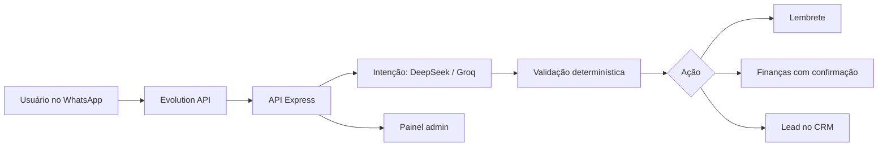

# Assistente Pessoal no WhatsApp

Assistente de WhatsApp que entende texto e áudio, cria lembretes, organiza finanças e hábitos, gera documentos e pode criar leads num CRM — com assinaturas por plano e painel administrativo.

    

> Projeto real. Este repositório é uma **cópia de portfólio**: segredos, servidores e nomes de empresas foram removidos ou trocados pelo nome fictício "Natela".

## Sumário

1. [O que o projeto faz](#1-o-que-o-projeto-faz)
2. [Instalação e requisitos](#2-instalação-e-requisitos)
3. [Como rodar e usar](#3-como-rodar-e-usar)
4. [Demo visual](#4-demo-visual)
5. [Suporte e ajuda](#5-suporte-e-ajuda)
6. [Contribuição e manutenção](#6-contribuição-e-manutenção)
7. [Licença e status](#7-licença-e-status)

## 1. O que o projeto faz

**O que resolve:** Profissionais autônomos perdem lembretes, gastos e tarefas espalhados em vários apps, quando o canal que realmente usam o dia todo é o WhatsApp.

**Como resolve:** Um assistente que vive no WhatsApp: classifica a intenção de cada mensagem (texto ou áudio), executa a ação certa e confirma antes de mexer em finanças ou dados importantes.

**Para quem é:** Profissionais autônomos e pequenas equipes que vivem no WhatsApp.

**Por que importa:** Organização sem instalar nada novo, com validação determinística para a IA não inventar dados.

### Principais benefícios

| Lembretes e finanças por mensagem | Entende áudio | Planos e painel admin |
|---|---|---|

### Funcionalidades

- Classificação de intenção com DeepSeek/Groq e validação determinística
- Transcrição de áudio (Whisper) e resposta em voz (ElevenLabs)
- Lembretes, hábitos, finanças com confirmação, comprovantes, contratos e planilhas
- Criação de lead num CRM vinculado à conta do cliente
- Assinaturas por plano (Essencial, Pro, Business) com recursos por plano
- Painel admin: contatos, assinaturas, conexão do WhatsApp por QR, troca e recuperação de senha
- Jobs de lembrete, reengajamento proativo e limpeza; allowlist e anti-flood

## 2. Instalação e requisitos

### Pré-requisitos

| Ferramenta | Versão |
|---|---|
| Node.js | 22 |
| npm | 10+ |
| PostgreSQL | 15 |
| Redis | 7 |
| Evolution API | v2 |

### Instalação

```bash
git clone https://github.com/jhonatancamargo121/assistente-pessoal-whatsapp.git
cd assistente-pessoal-whatsapp/app
npm install
```

Crie `app/.env` com as variáveis abaixo (a lista completa e validada está em `app/src/config.ts`).

### Variáveis de ambiente

| Variável | Para que serve |
|---|---|
| `DATABASE_URL / REDIS_URL` | Banco e cache |
| `EVOLUTION_URL / EVOLUTION_API_KEY / EVOLUTION_INSTANCE` | Canal de WhatsApp |
| `DEEPSEEK_API_KEY / GROQ_API_KEY` | Modelos de intenção, conversa e voz |
| `JWT_SECRET / ENCRYPTION_KEY` | Sessão do painel e cifra de dados |
| `CRM_API_URL / CRM_API_KEY` | Integração opcional com CRM |

A lista completa, com comentários, está no `.env.example`. Nenhum valor real é versionado.

## 3. Como rodar e usar

### Quick start

```bash
docker compose -f ../infra/docker-compose.yml up -d
npm run dev
```

O esquema do banco está em `infra/001_init.sql`.

### Exemplo de uso

Requisição:

```bash
curl http://localhost:3000/health
```

Resposta esperada:

```json
{"ok": true}
```

## 4. Demo visual

Fluxo principal:



> Prints e GIF com dados fictícios estão no roadmap. Para ver o sistema rodando, siga o [Quick start](#3-como-rodar-e-usar).

## 5. Suporte e ajuda

- **Documentação:**
  - [Histórico de mudanças](CHANGELOG.md)
  - [Esquema do banco](infra/001_init.sql)
- **Issues:** abra uma [issue](https://github.com/jhonatancamargo121/assistente-pessoal-whatsapp/issues) para reportar problemas ou sugerir melhorias.
- **Discussions:** dúvidas gerais em [Discussions](https://github.com/jhonatancamargo121/assistente-pessoal-whatsapp/discussions).
- **Contato:** pelo perfil [@jhonatancamargo121](https://github.com/jhonatancamargo121)

## 6. Contribuição e manutenção

### Como contribuir

1. Faça um **fork** do repositório
2. Crie uma **branch** a partir da `main` (`git checkout -b feat/minha-melhoria`)
3. Abra um **Pull Request** descrevendo o que mudou e por quê

### Padrões

- Commits no padrão [Conventional Commits](https://www.conventionalcommits.org/pt-br/) (`feat:`, `fix:`, `docs:`…)
- Lint e formatação passando antes do PR
- Testes rodando antes do PR

### Como rodar os testes

```bash
node eval.js
```

### Mantenedores

| | |
|---|---|
| **Jhonatan Camargo** ([@jhonatancamargo121](https://github.com/jhonatancamargo121)) | Mantenedor |

## 7. Licença e status

### Licença

Código proprietário, publicado para fins de portfólio. Todos os direitos reservados; veja o arquivo [LICENSE](LICENSE).

### Status


### Próximos passos

- [ ] Suíte de testes unitários além da avaliação de intenções
- [ ] Integração com calendário
